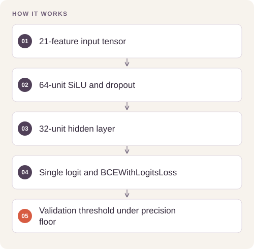

# Diabetes Risk Classification with PyTorch

Study the sensitivity–precision trade-off of tabular neural classifiers while preventing duplicate feature vectors from leaking across data splits.

## Implementation

A configurable SiLU tabular MLP and validation-only threshold selection under a precision floor.




## Train the tabular neural model

The new full-data UCI CDC reference run uses duplicate-feature-group-safe splits, training-only scaling and validation-only threshold selection. The 50,736-row test has86.16% accuracy but only**1.13% positive-class recall** at the selected threshold. Fitted feature order, scaler and threshold accompany the checkpoint.

[Commands, artifacts and benchmark scope](BENCHMARKS.md) · [Versioned profiles](reproduction.json)


## Try a small example

Generated tensors and a small threshold fixture exercise the model interface and selection rule. These outputs are not trained risk estimates or clinical validation.

After the local setup below, run from the repository root:

```sh
python examples/quickstart.py
```

The [example source](examples/quickstart.py), [captured output](examples/expected-output.txt) and [execution record](examples/environment.json) keep this demonstration inspectable. Floating-point values may vary with library versions.

Observed output from this run:

```text
{
  "logits_shape": [
    4,
    1
  ],
  "loss": 0.6969482898712158,
  "threshold_example": {
    "threshold": 0.6,
    "validation_recall": 1.0,
    "validation_precision": 1.0
  }
}
```

## Completed study

The saved SiLU experiment reports test recall 0.8253, precision 0.7145, F1 0.7659, and ROC AUC 0.8235 at threshold 0.47. It records 4,137 true positives, 876 false negatives, 1,653 false positives, and 3,317 true negatives.

These historical figures describe the completed study. This refactored standalone implementation has separate validation and has not been used to recertify the historical benchmark. The public release contains the portable core and focused tests.

## Run locally

Python 3.11 or later.

```sh
python -m venv .venv
source .venv/bin/activate
python -m pip install -r requirements.txt
python smoke_test.py
```

Prepare your own inputs as described in [DATA.md](DATA.md). Tests use generated fixtures and do not need credentials or provider calls. [VALIDATION.md](VALIDATION.md) records their scope.

## Practical relevance and limitations

This is a retrospective classification study, not a clinical decision tool. Multiple experiments are reported on the same test partition, so the record should not be treated as a fresh external validation. Thresholds and prevalence may not transfer to another population.

## Reuse

Original reproduction and validation tooling is available under MIT; see [LICENSING.md](LICENSING.md) for the explicit file scope and preserved upstream, dataset and checkpoint terms.
